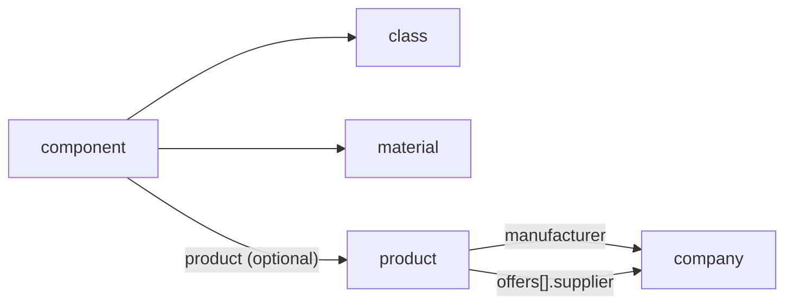

# Plan: Bauteile als Produkte (Hersteller, Lieferanten, Preise)

## Context

- Bauteile (`catalog/components/*.json`) = Klasse + `params` + `materials`; Schema `catalog/schema/component.schema.json` hat `additionalProperties: false`.
- Hersteller/Lieferant/Preis stehen heute nur als Freitext in `description` (z. B. window-kammer: "Neuffer Best. 3308385 ... IDEAL 4000 ... 247,94 €"; velux-ck04: "Schuck Dach RE 17.07.2023 ... 680,00 €").
- `glass-double` / `glass-triple` sind keine Materialien, sondern Verglasungsaufbauten. Der Aufbau ist bereits über die Klassenparameter `glazing_type` (single|double|triple) und `ug_value` abgebildet. 17 Dateien referenzieren sie (Klasse window als Default, 15 Bauteile).
- Programme sind nicht-Code md-Specs: `weingaerten-core.md`, `weingaerten-web.md`, `weingaerten-doku.md`; Code entsteht im Cache, danach `scripts/rehash_cache.py`, Neustart über `start.cmd`.

## Datenmodell



Neuer Katalogtyp **Firma** `catalog/companies/<id>.json`, Ref `company:<id>`:

```json
{ "id": "neuffer", "name": "Neuffer Fenster + Türen", "roles": ["supplier"],
  "description": "...", "address": "...", "web": "..." }
```

`roles` ⊆ `manufacturer|supplier` (eine Firma kann beides sein).

Optionaler Block `product` im Bauteil:

```json
"product": {
  "manufacturer": "company:ideal",
  "model": "IDEAL 4000",
  "article_no": "...",
  "offers": [
    { "supplier": "company:neuffer", "price": 247.94, "currency": "EUR",
      "price_basis": "net|gross", "date": "2023-07-30",
      "source": "Best. 3308385, Pos. 1" }
  ]
}
```

Bauteile ohne `product` (z. B. selbst gebaut) bleiben gültig. Preis je Stück.

Glas: ein Material `glass` "Floatglas" (Kategorie Glas, λ 1,0, ρ 2500, A1). Rolle `glazing` aller Fenster -> `material:glass`; Anzahl Scheiben bleibt in `glazing_type`. `glass-double`/`glass-triple` werden gelöscht. Optional: Web-Glasfarbe je `glazing_type` leicht abdunkeln (vorher Unterschied über Materialfarbe).

## Implementation steps

1. **Schemas**: neu `catalog/schema/company.schema.json`; `component.schema.json` um optionales `product` erweitern (manufacturer/supplier Pattern `^company:...`, `offers` Liste, price >= 0, date ISO).
2. **Core-Spec** (`weingaerten-core.md`): Typ `company` laden (CATALOG, ELEMENT, RESOLVE, SAVE, DELETE, USAGE); Validierung: `manufacturer` muss Firma mit Rolle `manufacturer` sein, `supplier` mit Rolle `supplier`, sonst Fehler; DELETE einer verwendeten Firma -> `wird verwendet von`. BOM `components[]` zusätzlich `manufacturer`, `unit_price` (günstigstes bzw. erstes Angebot), `total_price`; `totals.component_price`. Testerwartungen anpassen.
3. **Web-Spec** (`weingaerten-web.md`): neue Seite `/katalog/firmen` (Menü unter Katalog, Formular Name/Rollen/Beschreibung/Adresse/Web); Bauteil-Karte: Abschnitt `Produkt` (Hersteller-Select gefiltert auf Rolle, Modell, Artikelnr., Angebotstabelle mit Zeilen hinzufügen/entfernen: Lieferant, Preis, netto/brutto, Datum, Quelle); `/mengen` Tabelle Bauteile um `Hersteller | Stückpreis | Summe` erweitern; API-Ref-Patterns um `company`. check\_web-Erwartungen ergänzen.
4. **Doku** (`weingaerten-doku.md`): Abschnitt Produkte/Firmen, Tabelle Datenordner.
5. **Daten migrieren**: Firmen anlegen aus den Rechnungen/Beschreibungen (z. B. neuffer, ideal/aluplast, schuck-dach, velux, ...); bei jedem Bauteil `product` aus `description` befüllen, Beschreibung um Preis/Lieferant kürzen. `material:glass` anlegen, alle `glazing`-Rollen und den Klassen-Default umstellen, glass-double/-triple löschen.
6. **Generieren und prüfen**: Cache neu erzeugen, `scripts/rehash_cache.py`, Server neu starten.

## Verification

- `scripts/core_validate.py`: Modell gültig, keine Referenz auf glass-double/-triple (grep).
- `scripts/smoke_core.py` / `smoke_baseline.py` (bekannter wall-split-Fehler ausgenommen): SAVE mit falscher Firmenrolle -> Fehler; DELETE verwendeter Firma -> `wird verwendet von`.
- `scripts/check_web.py`; manuell: `/katalog/firmen`, Bauteil-Karte mit Angeboten editieren und speichern, `/mengen` zeigt Preise und Summe.

## Critical Files

- catalog/schema/component.schema.json - product-Block
- weingaerten-core.md - Typ company, Validierung, BOM-Preise
- weingaerten-web.md - Seite Firmen, Produkt-Formular, Mengen
- catalog/classes/window\.json - Default glazing -> material:glass
- catalog/components/window-kammer.json - Beispiel-Migration

## Annahmen (bitte bestätigen oder korrigieren)

- Firma als ein Typ mit Rollen statt getrennter Hersteller-/Lieferanten-Typen.
- Produktdaten direkt am Bauteil (kein separater Produkt-Katalog), Preis je Stück.
- TGA-Komponenten bekommen den `product`-Block vorerst nicht (später gleiches Muster möglich).
