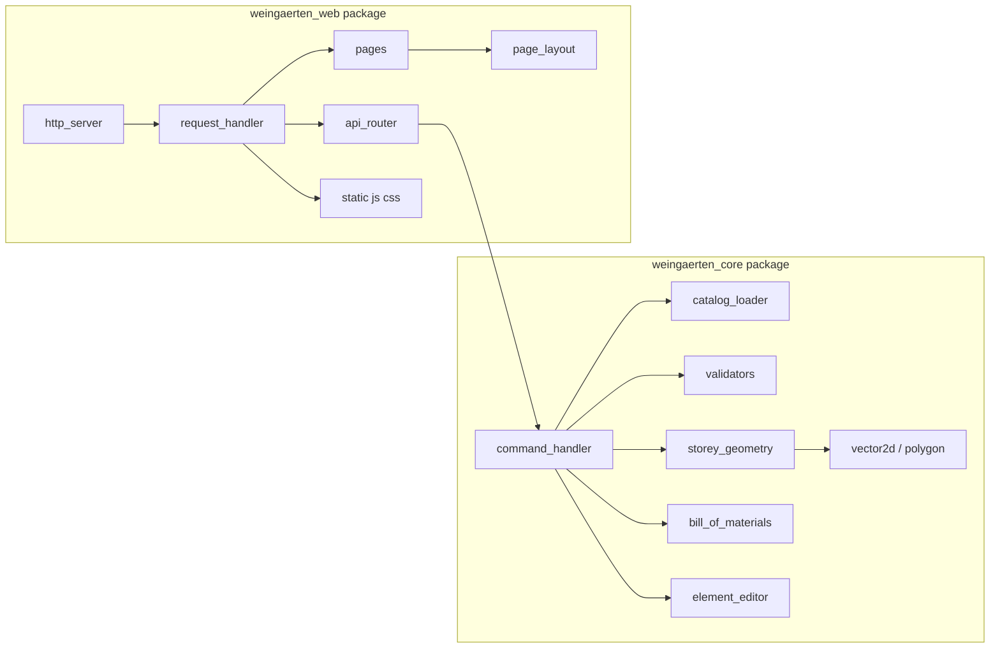

# Plan: Clean-code refactoring of the generated Python code (core + web)

## Context
- The code is a **generated cache** (non-code approach):
  - `%LOCALAPPDATA%\non-code-cache\weingaerten-core\weingaerten_core.py` (1679 lines) is generated from the "Core specification" section in [weingaerten-core.md](weingaerten-core.md).
  - `%LOCALAPPDATA%\non-code-cache\weingaerten-web\web_server.py` (1620 lines) is generated from the "Server specification" section in [weingaerten-web.md](weingaerten-web.md).
  - `.hash\*.sha256` is the SHA-256 of the spec section. Changing the spec means regeneration, so a refactoring is only durable if it goes through the spec (**user decision**).
- Both specs currently require "Single Python 3 file". That contradicts [skills/clean-code.instructions.md](skills/clean-code.instructions.md): classes, one class per file, at most 256 lines per file, at most 80 lines per function, docstrings, type hints, logging.
- Current state of the core: only module-level functions; `_compute_storey` is about 480 lines with nested helpers; there are 1-line vector helpers (`_sub`, `_add`, ...) and short names (`m`, `el`, `_r`).
- Current state of the web server: page functions `p_*`, large JS/CSS strings (`PLAN_JS`, `KAT_JS`, `WAND_JS`, `CSS`, ...), handler `H`, short names (`E`, `de`, `cm`). The core is loaded via `importlib` from one file path.
- JS/CSS go into **static files** (user decision).

## Target structure

Proposed module split (finalized in step 1 after reading the files completely):
- **weingaerten_core/**
  - `__init__.py`: re-exports `handle`.
  - `command_handler.py` (`CommandHandler`): dispatch and lock.
  - `model/`: `catalog_loader.py` (`CatalogLoader`, mtime cache), `model_store.py`.
  - `validation/`: `schema_validator.py`, `element_validator.py`, `class_validator.py`, `product_validator.py`.
  - `geometry/`: `vector2d.py`, `polygon.py` (clip, area, offset, point-in-polygon), `wall_frame.py`, `wall_layer_builder.py`, `opening_builder.py`, `room_builder.py`, `ceiling_builder.py`, `foundation_builder.py`, `storey_builder.py` (replaces `_compute_storey`, at most 80 lines per method).
  - `resolution/reference_resolver.py`, `house_builder.py`, `bom/bill_of_materials.py`.
  - `editing/`: `element_editor.py` (SAVE/DELETE), `opening_editor.py`, `walls_editor.py`, `json_file_writer.py`.
- **weingaerten_web/**
  - `__main__.py` / `main`, `http_server.py` (IPv4 + IPv6), `request_handler.py`, `request_guard.py` (host, origin, content type, size), `api_router.py`, `core_client.py` (loads the core package).
  - `rendering/`: `page_layout.py`, `formatting.py` (German number format, escaping), `markdown_renderer.py`, `svg_plan_renderer.py`.
  - `pages/`: one class per page (haus3d, grundriss, waende, katalog, mengen, doku, about).
  - `static/`: `style.css`, `common.js`, `haus3d.js`, `plan.js`, `katalog.js`, `wand.js`, `front.js`, `tip.js`, `roundel.svg`.
- Public interfaces stay unchanged: `handle(command_json: str) -> str`, all routes, all API answers, and the verification strings checked in Step 5.

## Implementation steps
1. **Analysis:** read both files completely and map each function to its target module and class. Find duplicated code (`REF_RE`/`EDIT_RE`/`ID_RE` exist in both files; the core becomes the single source, and the web server imports the patterns from there or keeps its own copy, as the spec says).
2. **Update [weingaerten-core.md](weingaerten-core.md):**
   - Core specification: "Single Python 3 file" becomes the package `weingaerten_core\` with the listed modules plus the clean-code requirements (reference to the skill: classes, size limits, docstrings, type hints, `logging` without output to stdout during the smoke test).
   - Cache folder and Step 1: the cache check tests the package (`weingaerten_core\__init__.py`) instead of the single file; regenerating deletes the old package or file first.
   - Step 2: `python -m compileall` instead of `py_compile`; smoke test unchanged.
3. **Update [weingaerten-web.md](weingaerten-web.md):**
   - Exception list: add row #3, "Static web assets (JS/CSS/SVG)", created from the Server specification, cache files `static\*`.
   - Server specification: package `weingaerten_web\`, assets in `static\`, served at `GET /static/<file>` (whitelist, `text/javascript` / `text/css`) or read at start and embedded inline. Decided in step 1 by the CSP and offline requirement; the verification strings must stay intact.
   - Core loading: import the package (put the cache folder on `sys.path`, then `import weingaerten_core`), instead of `spec_from_file_location` on one file.
   - Step 2/3/4 and the pid search: start command `python -m weingaerten_web` with the cache folder as working directory, or `python ...\weingaerten_web\__main__.py`.
4. **Regenerate the core:** write the package, run `compileall`, run [scripts/smoke_core.py](scripts/smoke_core.py) (adjust its import if it loads the single file), write the hash.
5. **Regenerate the web server:** stop the running server (memory: stop it before implementing), generate, start it, run [scripts/check_web.py](scripts/check_web.py) (adjust its pid or start path), write the hash.
6. **Check clean-code limits:** a read-only check script in `scripts/` (gitignored) measures file lengths at most 256 and function lengths at most 80 via `ast`, and checks docstrings, return-type hints and `logging.getLogger` in every module.
7. **Documentation:** update the architecture table in [weingaerten-doku.md](weingaerten-doku.md) (line 141) to the package structure, because the code goes into the technical documentation. Then delete the old single files from the cache.

## Verification
- `python -m compileall` on both packages without errors.
- `scripts/smoke_core.py`: all checks from Step 2.4 of the Core specification are green, with identical numbers (±0.001).
- `scripts/check_web.py`: all routes, strings and API checks from Step 5 of the Server specification are green, including 400/403/415 cases.
- Limit check script: 0 files over 256 lines, 0 functions over 80 lines, 0 public classes or methods without a docstring.
- Manual check in the browser: `/haus3d`, `/grundriss` (edit), `/waende`, catalog forms.

## Risks
- **Embedded JS in its own file:** spec checks such as "`/haus3d` contains a `<script type=\"module\"`" and `planedit`/`katdata` must still be found in the HTML. Keep IDs and inline bootstrap tags in the HTML and move only the logic out.
- **Regeneration is non-deterministic:** the result depends on how precisely the spec describes the structure, so the module list goes into the spec as a mandatory structure.
- `_compute_storey` has to be split into many classes, which is the biggest risk for differences in geometry. The smoke-test numbers serve as a regression net.

## Critical files
- [weingaerten-core.md](weingaerten-core.md) - Core specification, cache rules, smoke test
- [weingaerten-web.md](weingaerten-web.md) - Server specification, exception list, start/check
- [skills/clean-code.instructions.md](skills/clean-code.instructions.md) - rules to follow
- [scripts/smoke_core.py](scripts/smoke_core.py), [scripts/check_web.py](scripts/check_web.py) - regression checks
- [weingaerten-doku.md](weingaerten-doku.md) - architecture section of the technical documentation
