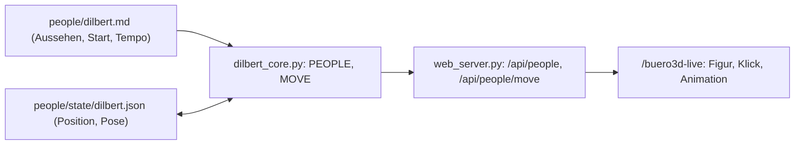

# Plan: Dilbert – erste Person mit Gehen, Drehen, Sitzen

## 1. Context

- Die App besteht nur aus Prompts: dilbert-core.md (Core, `handle(command_json)`), dilbert-web.md (Server und Seiten) und dilbert-doku.md. Der generierte Code liegt im Cache: `%LOCALAPPDATA%\non-code-cache\dilbert-core\dilbert_core.py` und `...\dilbert-web\web_server.py`. Der Code wird nur über eine Spec-Section erzeugt, mit SHA-256 je Section.

- Der Core liefert mit `LAYOUT` bereits Räume, Türen (mit Breite), Ausgang, Fenster, Möbel (Grundfläche, `rotation`, `z`, `height`) und Raumhöhen. Die Wandläufe und Türöffnungen berechnet heute nur das Web (`wall_runs`, `wall_boxes`). Für die Wegplanung braucht der Core sie selbst und bekommt sie in einer eigenen Hilfsfunktion.

- `/buero3d-live` nutzt three.js r160 (Ausnahme #2) mit Raycasting-Hover auf Möbeln und Böden. Dort kommen Dilbert und die Klicksteuerung hinzu.

- `people/` ist leer (nur `.gitkeep`) und für Personen reserviert.

- Entscheidungen des Users:

  - Dilbert erscheint nur in **Büro 3D live**.
  - **Wegplanung und Bewegung rechnet der Core.**
  - Positionen kommen **nicht in die .md-Datei**, sondern in eine eigene JSON-Datei in einem Unterordner.

## 2. Implementation steps

### Schritt 1 – Person-Prompt `people/dilbert.md` (neu, kein Code)

- Gleiche Form wie die anderen Prompts: Front-Matter (`name: dilbert`), Hinweis „non-code", Abschnitt `## Documentation`.

- Abschnitt `## Person data` mit **einem** \`\`\`json-Block, den der Core liest:

  - `id` = `dilbert`, `name` = `Dilbert`
  - `height` 1.75, `radius` 0.25 (Platzbedarf beim Gehen), `speed` 1.2 m/s, `turn_speed` 180 °/s, `sit_step` 0.4 s
  - `start`: `{"seat": "buero1-chair-1"}` (Stuhl am Schreibtisch in Büro 1, Pose `sitzen`)
  - `look` (einfache Zeichnung): Hemd `#FFFFFF`, Hose `#333333`, Krawatte `#C62828` (nach oben gebogen), Haut `#F2C9A0`, Haare `#5D4037`, Brille `#1A1A1A`

- Kurzer Text: Dilbert ist Ingenieur in Büro 1. Die allgemeinen Fähigkeiten (gehen, stehen, sitzen) stehen im Core, hier steht nur, was ihn ausmacht.

### Schritt 2 – Zustandsdatei `people/state/<id>.json`

- Der Core schreibt sie, der Mensch nicht: `{id, x, y, heading, pose, seat, updated_at}`. `heading` in Grad, 0 = Norden, im Uhrzeigersinn; `pose` ist `stehen` oder `sitzen`.
- Fehlt die Datei oder ist sie ungültig, gilt `start` aus der Person-Data: Position = Stuhlmitte, Blick vom Schreibtisch weg, Pose `sitzen`.
- `.gitignore` bekommt `people/state/` (die Werte ändern sich ständig).

### Schritt 3 – Core-Spec erweitern (dilbert-core.md)

- **Hard rules:** Zur Laufzeit liest der Core `DILBERT_PEOPLE_DIR\*.md` (nur den JSON-Block unter `## Person data`). Schreiben darf er nur `DILBERT_PEOPLE_DIR\state\<id>.json`, atomar über eine temporäre Datei und Rename.
- **Neue Befehle:**

| Befehl   | Felder                                                | Antwort                                                      |
| -------- | ----------------------------------------------------- | ------------------------------------------------------------ |
| `PEOPLE` | –                                                     | `{people: [{id, name, height, radius, speed, look, state}]}` |
| `MOVE`   | `person`, `target`: `{furniture: <id>}` oder `{x, y}` | `{person, actions: [...], state: <Endzustand>}` oder `error` |

- **Personenmodell (gilt für alle Personen):**

  - Posen: `stehen`, `sitzen`, `gehen`.
  - **Gehen:** Schritte geradeaus oder in Kurven. Erlaubte Richtungsänderungen: **30, 60, 90, 130, 180°** nach links oder rechts.
  - **Hinsetzen** in 3 Schritten: `sitzen 1` (vor den Stuhl drehen und Knie beugen), `sitzen 2` (absenken), `sitzen 3` (sitzt, Rücken an der Lehne).
  - **Aufstehen** ist die Umkehrung in 3 Schritten. Es läuft automatisch vor jedem Gehen, wenn die Person sitzt.

- **Wegplanung:**

  - **Raster:** 0,1 m über das Gebäude.
  - **Blockiert:** Wände (Dicke + `radius`) und alle Möbel mit ihrer Grundfläche + `radius`. Ausnahmen sind der Zielstuhl und Gegenstände, die über 0 hoch hängen und unter denen man durchgehen könnte (es gibt keine).
  - **Türen und Ausgang** sind offen, also Wandläufe minus Öffnungen, dieselbe Logik wie im Web, jetzt im Core.
  - **Suche:** A\* mit 8 Nachbarn. Die Kosten steigen leicht in Wandnähe, so geht die Person mittig durch Türen und weicht Hindernissen mit Abstand aus.
  - **Glätten:** Ecken abschneiden, solange die Sichtlinie frei ist. Das ergibt den „direkten Weg durch Türen".
  - **Winkel anpassen:** Jeder Knick wird auf den nächsten erlaubten Winkel gerundet; eine Restabweichung wird auf das nächste Teilstück verteilt. Dann wird geprüft, dass das angepasste Teilstück frei bleibt; sonst bleibt der ungerundete Knick und die Aktion wird `kurve <gerundeter Winkel>` benannt.

- **Ziel:**

  - **Stuhl:** Annäherungspunkt vor dem Stuhl auf der Seite gegenüber der Lehne, dann `sitzen 1–3`, Endpose `sitzen`, `seat` = Stuhl-ID.
  - **Anderes Möbel:** Nächster freier Punkt im Abstand `radius` + 0,1 vor der Grundfläche, Blick zum Möbel, Endpose `stehen`.
  - **Bodenpunkt:** Liegt der Punkt blockiert, wird der nächste freie Punkt genommen. Unerreichbares Ziel ergibt `{"error": "Ziel nicht erreichbar"}`.

- **Aktionen:** Jede Aktion hat `duration` in Sekunden, berechnet aus `speed`, `turn_speed` und `sit_step`.

  - `{type: "aufstehen", step: 1..3}`
  - `{type: "drehen", angle: ±30|60|90|130|180}`
  - `{type: "gehen", from: [x, y], to: [x, y], heading}`
  - `{type: "sitzen", step: 1..3}`
  - `{type: "stehen"}`

- Nach jedem erfolgreichen `MOVE` schreibt der Core den **Endzustand** sofort in die Zustandsdatei. Ein Reload während der Animation zeigt die Person also gleich am Ziel.

- Thread-Safety: ein Lock um `MOVE` und das Schreiben des Zustands.

- **Smoke-Test** (Schritt 2.4 im Prompt) erweitern:

  - `PEOPLE` liefert Dilbert, sitzend in Büro 1.
  - `MOVE` zum Küchenstuhl: der Weg geht durch die Tür von Büro 1, den Flur und die Küchentür; kein Wegpunkt liegt in einer Wand oder einem Möbel mit Abstand `radius`; alle `drehen`-Winkel liegen in {30, 60, 90, 130, 180}; die Folge endet mit `sitzen 3`; die Zustandsdatei ist geschrieben.
  - Ein Bodenpunkt in einer Wand liefert den nächsten freien Punkt; ein Punkt außerhalb des Gebäudes liefert `error`.
  - Der Test läuft mit `DILBERT_PEOPLE_DIR` = Temp-Kopie von `people/`, damit der echte Zustand unverändert bleibt.

### Schritt 4 – Web-Server (dilbert-web.md)

- Start: zusätzlich `$env:DILBERT_PEOPLE_DIR = '<prompt folder>\people'`.

- **Neue Routen:**

  - `POST /api/people` ruft `PEOPLE`.
  - `POST /api/people/move` ruft `MOVE`.
  - Die Eingaben werden geprüft: `person` passt auf `^[a-z0-9-]{1,32}$`; `furniture` muss eine bekannte Möbel-ID sein; `x`, `y` sind Zahlen im Gebäude. Ungültige Eingaben ergeben 400. Für POST gelten dieselben Host-, Origin- und Content-Type-Prüfungen wie bisher.

- **`/buero3d-live`:**

  - **Figur „einfach gezeichnet"** (three.js-Gruppe, Toon-Material mit Konturen): Beine als 2 Boxen (Hose), Rumpf als Box (Hemd), Krawatte als dünne rote Box, deren Spitze nach oben geknickt ist (Dilbert-Erkennungszeichen), Kopf als Kugel, Brille als 2 kleine schwarze Torusringe. Höhe aus `height`. Pose `sitzen`: Beine waagrecht, Becken auf Sitzhöhe 0,45.

  - **Klick** (Linksklick ohne Ziehen, damit OrbitControls nicht stört): Raycast trifft Möbel → `{furniture: id}`, Boden → `{x, y}`. Ein POST auf `/api/people/move` liefert die Aktionsliste, die nacheinander abgespielt wird:

    - `gehen`: Position linear interpolieren, Beine schwingen gegenphasig.
    - `drehen`: Richtung über `duration` drehen.
    - `sitzen` / `aufstehen`: je Schritt eine Zwischenpose, also 3 sichtbare Stufen.
    - Ein neuer Klick bricht die laufende Animation ab. Die Figur springt dann auf den Zwischenstand, und für die neue Planung zählt der vom Core gespeicherte Endzustand des letzten `MOVE`.

  - **Rückmeldung:** eine kleine Statuszeile unter dem Canvas („Dilbert geht zu: Stuhl, Küche" / „Ziel nicht erreichbar"), Text per `textContent`. Der Hover auf Dilbert zeigt die Sprechblase `Dilbert`, die Pose und den Raum.

  - Beim Laden holt die Seite `/api/people` und setzt die Figur auf den gespeicherten Zustand.

### Schritt 5 – Doku und Gitignore

- dilbert-doku.md:

  - Abschnitt „Personen": Dilbert, die Fähigkeiten, Klick zum Bewegen.
  - Prompt-Tabelle ergänzen: `people\dilbert.md`, `people\state\`.
  - Security: Der Core schreibt nur die Zustandsdateien.

- .gitignore: `people/state/`.

### Schritt 6 – Code erzeugen, testen, starten

- Core neu erzeugen, kompilieren, Smoke-Test ausführen (`scripts\smoke_core.py` erweitern), Hash schreiben.
- Web neu erzeugen, kompilieren, Hash schreiben, Server neu starten (Port 8030).

## Annahme zum Drehwinkel

- 130° ist in der Liste. Ich übernehme ihn so; der Core rundet echte Knicke auf den nächsten Wert aus {30, 60, 90, 130, 180}.
- Falls 120° oder 135° gemeint war: Das ist nur ein Wert in der Core-Spec und schnell zu ändern.

## 3. Verification

- `python scripts\smoke_core.py`: bisherige Prüfungen plus die Personenprüfungen aus Schritt 3, alle ohne Fehler.

- HTTP-Prüfungen in Schritt 5 des Web-Prompts:

  - `POST /api/people` liefert Dilbert mit `pose` `sitzen` in Büro 1.
  - `POST /api/people/move {person: "dilbert", target: {furniture: "kueche-chair-1"}}` liefert 200, `actions` ist nicht leer und endet mit `sitzen` Schritt 3; danach steht in `people\state\dilbert.json` `seat` = `kueche-chair-1`.
  - Ungültige `person` ergibt 400, fremder `Origin` ergibt 403.

- Browser:

  - Auf `/buero3d-live` ist Dilbert am Schreibtisch in Büro 1 zu sehen.
  - Klick auf den Stuhl im Besprechungsraum: er steht in 3 Schritten auf, geht durch die Tür von Büro 1, den Flur und die Tür des Besprechungsraums, setzt sich in 3 Schritten. Er läuft durch keine Wand und kein Möbelstück.
  - Klick auf einen Bodenpunkt: er geht hin und bleibt stehen.
  - Reload: er sitzt bzw. steht am letzten Ziel.
  - Die Browser-Konsole zeigt keine Fehler.

## 4. Critical Files

- people/dilbert.md – neu: Personendaten von Dilbert (JSON-Block)
- dilbert-core.md – Personenmodell, `PEOPLE`/`MOVE`, Wegplanung, Zustandsdatei, Smoke-Test
- dilbert-web.md – neue API-Routen, Figur, Klick und Animation auf `/buero3d-live`, `DILBERT_PEOPLE_DIR`
- `%LOCALAPPDATA%\non-code-cache\dilbert-core\dilbert_core.py` – generierter Core (Wegplanung)
- `%LOCALAPPDATA%\non-code-cache\dilbert-web\web_server.py` – generierter Server mit three.js-Figur
