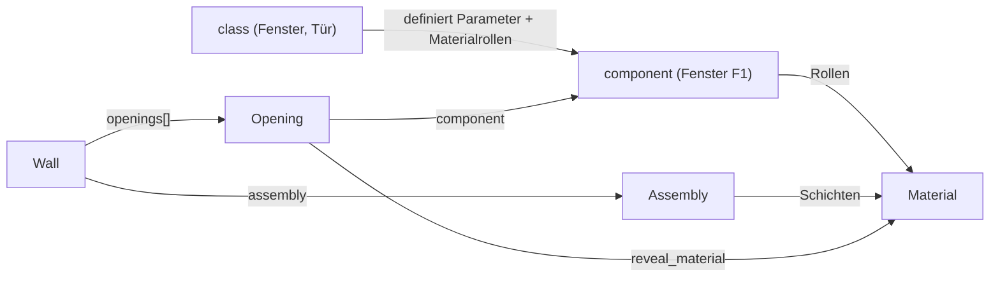

# Plan: Katalog-Umbau, Bauteile/Klassen, Öffnungen in Wänden

## Context

- Heute: Katalogtypen `material`, `assembly`, `opening`, `fixture` ([catalog/](<> "c:/Development/weingaerten/catalog")); eine Seite `/katalog`, Öffnungen/Einbauteile nur als JSON-Textfeld. Wände in [house/storeys/ground.json](<> "c:/Development/weingaerten/house/storeys/ground.json") mit leerem `openings: []`; der Core schreibt bisher nur `catalog\…`.
- Muster bleibt: Non-Code-Prompts [weingaerten-core.md](<> "c:/Development/weingaerten/weingaerten-core.md") / [weingaerten-web.md](<> "c:/Development/weingaerten/weingaerten-web.md"), Code nur im Cache, Spezifikations-Hash, Keys EN / Werte DE, eine JSON-Datei pro Element, Längen im Formular in cm, gespeichert in m.
- Entscheidungen: Unterseiten **Materialien, Aufbauten, Bauteile, Klassen**; Klassen **als Daten**; Öffnungen auf neuer Seite **Wände**; **Bauteil bestimmt** die Öffnungsgröße (+ Fuge).

## Datenmodell (neu/geändert)

- **`catalog/classes/<id>.json`** (Typ `class`): `id, name, description, geometry` (`window` | `door` | `box` – Zeichenrezept), `opening_capable` (Default für Bauteile), `parameters: [{key, name, type: length|number|choice|bool, default, min?, max?, options?, required}]`, `material_roles: [{key, name, default?}]`. Rezept-Pflichtparameter: `window`/`door` brauchen `width, height, depth, frame_width`; `window` zusätzlich `sashes` (choice 0/1/2).
- **`catalog/components/<id>.json`** (Typ `component`): `id, name, description, class: "class:<id>", opening_capable, params: {key: value}, materials: {role: "material:<id>"}`.
- **Öffnung in der Wand** (`walls[].openings[]`): `id, component, offset` (Abstand Wandanfang → linke Kante Rohbauöffnung, entlang der Referenzlinie), `sill` (Unterkante Rohbauöffnung ab Geschossboden), `joint` (Fuge je Seite, Default 0,01), `inset` (Einbautiefe von der Außenseite, Default 0,10), `reveal_material` (Laibung). Rohbauöffnung = Bauteilmaß + 2 · `joint`.
- Entfällt: Typen `opening`, `fixture` (Ordner + Schemas). Einbauteile (Steckdose) werden später eine weitere Klasse.
- Beispieldaten: Materialien `pvc-white` (Kunststoff weiß), `glass-triple` (3-fach-Verglasung), `wood-door` (Holz Tür); Klassen `window`, `door`; Bauteile `window-w1` (Fenster 2-flüglig 1,20 × 1,35), `door-d1` (Haustür 1,01 × 2,13); im EG zwei Fenster in `w-south`, eine Tür in `w-north`.

## Implementation steps

1. **Daten + Schemas**: `class.schema.json`, `component.schema.json`, `storey.schema.json` (Öffnungs-Item), `opening/fixture`-Schemas und -Ordner entfernen; Beispieldaten anlegen.

2. **Core-Spezifikation** ([weingaerten-core.md](<> "c:/Development/weingaerten/weingaerten-core.md")):

   - Laden von `classes/`, `components/`; Validierung: Parameter passend zur Klasse (Typ, Bereich, Pflicht, Auswahl), Materialrollen vorhanden, Rezept-Pflichtparameter; Öffnung: Bauteil `opening_capable`, Rohbauöffnung liegt innerhalb der **Innen- und Außenfläche** der Wand und unter der Wandoberkante, keine Überlappung von Öffnungen, `inset + depth` ≤ Wanddicke.
   - Geometrie: jede Schicht wird um die Rohbauöffnungen in **Stücke** zerlegt (links/rechts per Halbebenen-Clip senkrecht zur Wand, darunter/darüber als Teilhöhen) → `layers[].pieces[{footprint, z0, z1, volume}]`; Volumen und Flächen (außen/innen) automatisch abzüglich Öffnungen.
   - Je Öffnung: `rough` (u0, u1, z0, z1), Weltkoordinaten, **Laibungsflächen** (4 Quads mit Material + Fläche) und die **Teile des Bauteils** nach Rezept (Rahmenboxen, Flügel-Pfosten, Glasscheibe / Türblatt) als orientierte Boxen `{kind, material, center, size, direction}`.
   - `BOM`: Bauteile als Stückliste (Anzahl je Bauteil), Laibungsfläche je Material, Glasfläche.
   - `USAGE` erweitert (Klasse → Bauteile, Bauteil → Öffnungen, Material → Laibungen/Rollen). Änderung einer Klasse nur, wenn alle ihre Bauteile gültig bleiben (sonst Fehlerliste).
   - Neue Befehle `OPENING_SAVE {storey, wall, opening, create}` und `OPENING_DELETE {storey, wall, id}`: Änderung im Speicher anwenden, voll validieren, nur bei fehlerfreier Wand/Öffnung atomar in `house\storeys\<id>.json` schreiben (Schreibrecht nur für `openings` einer Wand). Smoke-Test-Erwartungen anpassen (neue Volumina, Öffnungsfälle).

3. **Core-Code** im Cache neu generieren, `scripts/smoke_core.py` erweitern, Hash schreiben.

4. **Web: Navigation + Katalog-Unterseiten** ([weingaerten-web.md](<> "c:/Development/weingaerten/weingaerten-web.md")): Menü `Katalog` mit eingerückten Untereinträgen `Materialien` (`/katalog/materialien`), `Aufbauten` (`/katalog/aufbauten`), `Bauteile` (`/katalog/bauteile`), `Klassen` (`/katalog/klassen`); `/katalog` → 302 auf Materialien. Gemeinsames Gerüst je Unterseite: sticky Leiste (`+ Neu`, Suche, auf-/zuklappen), einklappbare Karten, Löschen gesperrt bei Verwendung. **Kein JSON-Textfeld mehr.**

   - Materialien / Aufbauten: Formulare wie bisher.
   - **Bauteile**: beim Anlegen zuerst Klasse wählen → Formular wird aus den Klassenparametern erzeugt (Längen in cm, Auswahl als Select, bool als Checkbox), Materialrollen als Material-Selects mit Farbfeld, Checkbox `für Öffnungen geeignet` (Default aus Klasse); **Live-Vorschau** (SVG-Ansicht: Rahmen, Flügel, Glas) nach Rezept.
   - **Klassen**: Name, id, Rezept, `für Öffnungen geeignet`, Parameter-Editor (Zeilen: Schlüssel, Bezeichnung, Typ, Default, Min, Max, Auswahlwerte, Pflicht; ↑ ↓ ✕), Materialrollen-Editor; Hinweis auf Rezept-Pflichtparameter.

5. **Web: Seite `/waende`** (neu, Menü zwischen Grundriss und Katalog): Wandliste (Name, Länge, Aufbau, Anzahl Öffnungen) und Wandansicht als SVG (Umschalter Außen-/Innenansicht, Maßstab passend zur Breite): Wandfläche, Gehrungsenden, Öffnungen mit Bauteilzeichnung, **Maßkette** unten (Abstände/Breiten) und Brüstungshöhen.

   - `+ Öffnung`: Panel mit Bauteil (nur geeignete), Abstand links / Abstand rechts (wechselseitig berechnet), Brüstung, Fuge, Einbautiefe, Laibungsmaterial; Rechteck erscheint sofort.
   - Klick auf Öffnung = auswählen/bearbeiten; **Ziehen mit der Maus** verschiebt horizontal/vertikal (Raster 1 cm, Live-Werte im Panel), Pfeiltasten 1 cm / Shift 10 cm; `Löschen` mit Bestätigung; Konflikte (Überlappung, außerhalb) werden sofort rot markiert, Speichern erst bei gültiger Lage; Core-Fehler im Panel.
   - API: `/api/opening/save`, `/api/opening/delete` (gleiche POST-Sicherheitsregeln, Eingabeprüfung).

6. **Web: 3D und Grundriss** zeigen Öffnungen: 3D baut die Schicht-**Stücke** statt ganzer Prismen, Laibungen als dünne Flächen, Bauteile aus den Teil-Boxen (Glas transparent); Hover zeigt Bauteil/Öffnungsdaten. Grundriss: Wand unterbrochen, Fenster-/Tür-Symbol (Rahmen, Glaslinien, Türaufschlag). `/mengen` mit Bauteil-Stückliste und Laibungsflächen.

7. **Web-Code** im Cache neu generieren, `scripts/check_web.py` erweitern, Hash schreiben, Server auf 8008 neu starten.

8. **Doku** ([weingaerten-doku.md](<> "c:/Development/weingaerten/weingaerten-doku.md")) und Projektgedächtnis aktualisieren.

## Verification

- `python scripts/smoke_core.py` → `smoke=OK`, u. a.: Klasse/Bauteil gültig; Bauteil mit fehlendem Pflichtparameter oder Wert außerhalb Min/Max → Fehler; Öffnung über Wandende / über Oberkante / überlappend / nicht geeignetes Bauteil → Fehler, Datei unverändert; Ziegelvolumen sinkt exakt um Rohbauöffnung × Ziegeldicke; `DELETE component:window-w1` gesperrt solange verwendet; `OPENING_SAVE`/`OPENING_DELETE` auf Temp-Kopie.
- `python scripts/check_web.py` → `check=OK`: alle Unterseiten 200, `/katalog` → 302, kein `<textarea` auf Katalogseiten, `/waende` mit SVG und Öffnungs-Rechtecken, APIs inkl. Fehlerfälle; keine Schreibvorgänge im echten Datenbestand.
- Browser: Bauteil anlegen über Klassenformular; Öffnung auf `/waende` einfügen, ziehen, speichern, löschen; Ergebnis in 3D (Loch, Laibung, Fenster) und Grundriss prüfen; Konsole ohne Fehler.

## Critical Files

- [weingaerten-core.md](<> "c:/Development/weingaerten/weingaerten-core.md") - Datenmodell, Validierung, Schicht-Stücke, neue Befehle
- [weingaerten-web.md](<> "c:/Development/weingaerten/weingaerten-web.md") - Unterseiten, Seite Wände, 3D/Grundriss mit Öffnungen
- [catalog/schema/](<> "c:/Development/weingaerten/catalog/schema") - neue Schemas class/component, storey-Öffnungen
- [house/storeys/ground.json](<> "c:/Development/weingaerten/house/storeys/ground.json") - Öffnungen als Unterelemente der Wände
- `%LOCALAPPDATA%\non-code-cache\weingaerten-core\weingaerten_core.py` / `...\weingaerten-web\web_server.py` - generierter Code
