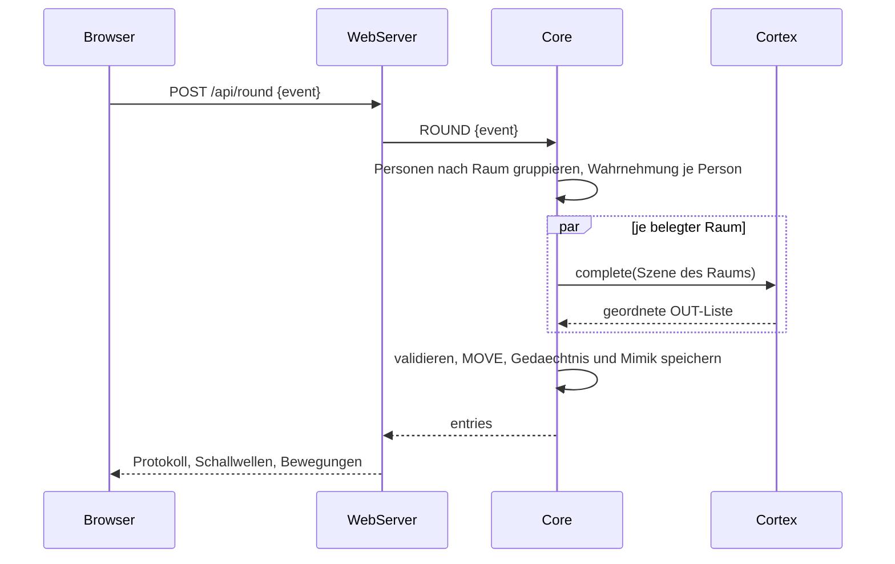

# Plan: Personen hören, sehen, reden (Cortex, ein Aufruf pro Raum)

## Context
- Core ([dilbert-core.md](dilbert-core.md)): `LAYOUT`, `PEOPLE`, `MOVE`; Zustand liegt in `people\state\<id>.json`; nur Standardbibliothek.
- Web ([dilbert-web.md](dilbert-web.md)): `/buero3d-live` spielt die `actions` aus `MOVE` ab; die POST-Endpunkte haben Host-, Origin-, Content-Type- und Größenprüfung.
- Entscheidungen:
  - Auslöser ist der Knopf „Runde“.
  - Zugriff über die Cortex-REST-API mit PAT.
  - Die `traits` fließen in den Prompt ein.
  - Gedächtnis aus den letzten Einträgen.
  - Optionales Textfeld „Ereignis“.
  - **Neu:**
    - Variante B, ein Aufruf pro Raum. Die Gedanken entfallen vorerst; es gibt kein Feld `thought` und keine Anzeige.
    - Modell `claude-haiku-4-5` (Punkt 4).
    - Kompakte Prompts (Punkt 5).
  - **Annahme:** Die Räume werden parallel abgefragt, weil sie unabhängig sind und das aus Variante B direkt folgt. Personen ohne neue Wahrnehmung werden *nicht* übersprungen (Punkt 2 wurde nicht gewählt).

## Ablauf einer Runde

## Core-Erweiterung (dilbert-core.md, neuer Abschnitt "Mind")
- **`ROOM_VIEW {person}`**: liefert den Raum der Person und die anderen Personen dort. Pro Person `{id, name, pose, x, y, heading, seat, near}`; `near` ist das Label des nächsten Möbelstücks im Umkreis von 1 m.
- **Wahrnehmung** (nur stehende oder sitzende Personen nehmen teil):
  - `heard`: Aussagen der vorigen Runde im selben Raum `{from, text}` und das Ereignis `{from: "Ereignis", text}`.
  - `seen`: Mimik und Haltung der vorigen Runde von Personen im selben Raum, deren Richtung höchstens 45° von der eigenen Blickrichtung abweicht.
  - `positions`: die Daten aus `ROOM_VIEW`.
- **Ein Aufruf pro belegtem Raum.** Der Prompt hat feste Bausteine:
  - System: Regeln. Antwort nur als JSON auf Deutsch. Pro Person höchstens 120 Zeichen `say` und höchstens 60 Zeichen `mimik`. Eine Person reagiert nur auf ihr eigenes `heard`/`seen` und auf das, was Personen *vor ihr in der Liste* in dieser Runde sagen (Sprechreihenfolge = Listenreihenfolge, sortiert nach id). Ziele nur aus `targets`.
  - User, kompaktes JSON:
    `{room, targets: [[id, label], …], persons: [{id, name, role, kw: [..], pose, near, heard, seen, memory}]}`.
    - `kw`: die Stichworte aus `traits.keywords`, nicht der lange Text.
    - `targets`: nur Stühle und Möbel im eigenen Raum, im Flur und in den Nachbarräumen (Räume mit gemeinsamer Tür zum Flur, ohne WC und Druckerraum außer als Ziel `drucker`/`wc` je ein Eintrag).
    - `memory`: die eigene Kurzzusammenfassung, höchstens 200 Zeichen.
  - OUT: `{persons: [{id, say: str|null, mimik: str|null, move: furniture-id|null, memory: str}]}`. `memory` ist die neue Kurzzusammenfassung, die nur die Person selbst wieder bekommt.
  - `max_tokens` = 150 × Anzahl der Personen im Raum; Timeout 20 s.
- **Validierung:**
  - Das erste `{…}` aus der Antwort wird geparst; nur bekannte ids und Felder werden übernommen.
  - Texte werden gekürzt.
  - `move` muss in `targets` stehen und wird über `MOVE` ausgeführt. Ein Fehler (z. B. Stuhl besetzt) wird im Eintrag vermerkt.
  - Bei einer ungültigen Antwort oder einem Timeout erhalten alle Personen des Raums `error: "keine Antwort"`; die anderen Räume laufen weiter.
- **`ROUND {event}`** liefert `{round, entries: [{person, name, room, say, mimik, move, actions, error}]}`. Die Reihenfolge ist Raum für Raum, innerhalb des Raums die Sprechreihenfolge.
- **Speicher:**
  - `state\<id>.json` bekommt `memory` (höchstens 200 Zeichen) und `mimik`.
  - `state\talk.json` enthält die Aussagen der letzten Runde mit Raum. Das ist die Grundlage für `heard` und `seen` in der nächsten Runde.
- **Cortex-Client** (urllib, Threads je Raum):
  - POST `<DILBERT_CORTEX_URL>/api/v2/cortex/inference:complete` mit den Headern `Authorization: Bearer <DILBERT_CORTEX_PAT>` und `X-Snowflake-Authorization-Token-Type: PROGRAMMATIC_ACCESS_TOKEN`.
  - Body `{model, messages, max_tokens}`; die SSE-Antwort wird zusammengesetzt.
  - Modell aus `DILBERT_CORTEX_MODEL`, Default `claude-haiku-4-5`.
  - Ohne URL oder PAT: `{"error": "Cortex nicht konfiguriert"}`.
  - Der PAT wird nie geloggt und nie zurückgegeben.
  - `DILBERT_CORTEX_FAKE=1` liefert feste Antworten, nur für den Smoke-Test.
- Mimik und Haltung sind reiner Text und werden nicht visualisiert.

## Web-Erweiterung (dilbert-web.md)
- `POST /api/round {event?}`:
  - `event` ist ein String mit höchstens 300 Zeichen.
  - Es gelten die gleichen Sicherheitsprüfungen wie bei den anderen POST-Endpunkten.
  - Läuft schon eine Runde, antwortet der Server mit 409 `Runde läuft`.
- **Unter dem Canvas:**
  - Eingabefeld „Ereignis (optional)“ und Knopf „Runde“. Während der Runde ist der Knopf gesperrt und der Status zeigt „Runde läuft …“.
  - Darunter ein scrollbares Protokoll, neueste Runde oben, Format `<Name>: „<say>“  (<mimik>)`.
  - Eine Bewegung erscheint als `→ geht zu <Label>`, Fehler in Rot. Alle Texte werden per `textContent` eingefügt.
- **Schallwellen-Symbol:**
  - Für jede Person mit `say` erscheinen 3 konzentrische Bögen vor dem Mund in Kopfhöhe, in Blickrichtung. Sie pulsieren 3 s lang.
  - Die Sprecher eines Raums kommen nacheinander dran, die Räume gleichzeitig.
  - Danach werden die `actions` wie bei den Klick-Bewegungen abgespielt.

## Doku (dilbert-doku.md)
- Neuer Abschnitt „Runden – Personen hören, sehen, reden“:
  - Wahrnehmungsregeln und das IN/OUT-Format.
  - Ein Aufruf pro Raum, das Modell und wie man es umstellt.
  - Einrichtung von PAT und URL über Umgebungsvariablen.
  - Hinweis, dass Gedanken vorerst entfallen.

## Implementation steps
1. Core-Spec: Abschnitt „Mind“ mit `ROOM_VIEW`, Wahrnehmung, Raum-Prompt, `ROUND`, Speicher und Cortex-Client; Smoke-Test erweitern.
2. Core-Code patchen, mit dem Fake-Cortex testen, dann py_compile und Hash.
3. Web-Spec und -Code: `/api/round`, Ereignisfeld, Knopf, Protokoll, Schallwellen, Abspielen; danach py_compile und Hash.
4. Doku ergänzen.
5. Server neu starten. Den PAT setzt du selbst als Umgebungsvariable; ich frage dann danach.
6. Eine echte Runde mit Ereignis spielen und im Browser prüfen.

## Verification
- Smoke-Test (Fake-Cortex):
  - `ROOM_VIEW alice` zeigt nur Personen in Büro 1.
  - Der Sichtkegel liefert für Alice (Blick Süd) nur Personen südlich von ihr.
  - `ROUND` ruft genau einmal pro belegtem Raum auf.
  - Die Einträge haben keine `thought`.
  - Eine Bewegung außerhalb von `targets` wird verworfen.
  - Ein besetzter Stuhl ergibt einen Eintrag mit Fehler.
  - Fehlende Konfiguration ergibt den Fehler „Cortex nicht konfiguriert“.
- Web:
  - `event` mit mehr als 300 Zeichen ergibt 400.
  - Eine parallele Runde ergibt 409.
- Browser: Protokoll und Schallwellen erscheinen, danach laufen die Bewegungen ab. Die Dauer der echten Runde wird gemessen und berichtet.

## Critical Files
- [dilbert-core.md](dilbert-core.md) - Mind, ROUND, Cortex-Client
- [dilbert-web.md](dilbert-web.md) - /api/round, UI, Schallwellen
- [dilbert-doku.md](dilbert-doku.md) - Nutzerdoku
- `%LOCALAPPDATA%\non-code-cache\dilbert-core\dilbert_core.py`, `...\dilbert-web\web_server.py` - generierter Code
