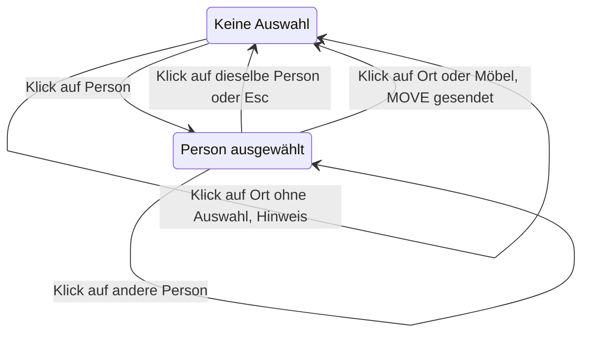

# Plan: Wally als zweite Person, Auswahl per Klick

## 1. Context

- Personen sind Prompts `people/<id>.md` mit einem JSON-Block `## Person data`. Der Core liest alle Dateien (`PEOPLE`), die Position steht in `people/state/<id>.json`. `MOVE` hat bereits ein Feld `person`, ist also schon für mehrere Personen gebaut.

- Heute nimmt `/buero3d-live` (`LIVE_JS` in `web_server.py`) bei jedem Klick fest die erste Person `dilbert`. Ein Klick auf eine Person wird ignoriert.

- Mit zwei Personen kommen zwei Lücken dazu:

  - Die Wegplanung kennt keine anderen Personen, Dilbert würde also durch Wally laufen.
  - Zwei Personen könnten denselben Stuhl wählen.

- **Wally** nach dem Bild: Glatze mit Haarkranz (Seiten und hinten), Brille, weißes Kurzarmhemd, dunkle Krawatte, immer eine grüne Kaffeetasse in der Hand. Etwas kleiner und rundlicher als Dilbert. „Zuerst nur bewegen auf Anweisung“ heißt: kein eigenes Verhalten, Wally geht nur, wenn man ihn auswählt und ein Ziel anklickt.

## 2. Implementation steps

### Schritt 1 – Neuer Personen-Prompt people/wally.md

- Gleicher Aufbau wie `dilbert.md`: Front-Matter `name: wally`, Abschnitt Documentation („Software-Ingenieur, berühmt fürs Kaffeetrinken und Nichtstun – bewegt sich vorerst nur auf Anweisung“), Abschnitt `## Person data`:

  - `id` `wally`, `name` `Wally`, `height` 1.70, `radius` 0.27, `speed` 0.9 (Wally ist langsamer), `turn_speed` 150, `sit_step` 0.5
  - `start`: `{"seat": "buero1-chair-4"}`, also der Platz schräg gegenüber von Dilbert im Schreibtisch-Block von Büro 1
  - `look`: `shirt` `#FFFFFF`, `pants` `#5D4E37`, `tie` `#2F3B2F`, `skin` `#F2C9A0`, `hair` `#CFCFCF`, `glasses` `#1A1A1A`, `hair_style` `fringe` (Haarkranz statt Kappe), `mug` `#5DAA4A` (Tasse in der rechten Hand), `build` `round` (Rumpf 15 % breiter)

- people/dilbert.md: Zeile **Control** auf die neue Bedienung anpassen; `look.hair_style` `cap` ergänzen.

### Schritt 2 – Core (dilbert-core.md und `dilbert_core.py`)

- **Personen als Hindernisse:** Beim `MOVE` von Person A werden alle **anderen** Personen an ihrer gespeicherten Position blockiert, als Kreis mit Radius = deren `radius` + A.`radius`. Die Prüfung erfolgt auf demselben Raster wie die Möbel.

- **Besetzter Stuhl:** Ist der Zielstuhl der `seat` einer anderen Person, antwortet der Core mit `{"error": "Stuhl besetzt von <Name>"}`.

- **Zielpunkt auf einer anderen Person:** Es wird der nächste freie Punkt genommen, wie bei Wänden.

- **Smoke-Test** (Schritt 2.4 im Prompt und `scripts\smoke_core.py`):

  - `PEOPLE` liefert `dilbert` und `wally`, beide sitzend in Büro 1.
  - Ein `MOVE` von Dilbert auf Wallys Stuhl ergibt `Stuhl besetzt`.
  - Ein `MOVE` von Wally zur Küche läuft nirgends näher als die Summe der Radien an Dilbert vorbei, und beide Zustandsdateien sind korrekt.

### Schritt 3 – Web-Spec (dilbert-web.md, `/buero3d-live`)

- Bullet **Click to move** ersetzen durch **Select, then move**:

  - **Klick auf eine Person** (Linksklick ohne Ziehen, < 5 px) wählt sie aus:

    - Die Figur leuchtet blau.
    - Am Boden liegt ein blauer Ring (Radius 0,35–0,45 m), der der Figur folgt.
    - Statuszeile: `<Name> ausgewählt – Zielort oder Möbel anklicken (Esc = abbrechen)`.

  - **Klick auf dieselbe Person** oder **Esc** hebt die Auswahl auf. **Klick auf eine andere Person** wechselt die Auswahl.

  - **Klick auf Ort oder Möbel mit Auswahl:** `MOVE` für die ausgewählte Person, danach ist die Auswahl aufgehoben.

  - **Ohne Auswahl:** Statuszeile `Zuerst eine Person anklicken`, kein `MOVE`. Wände sind kein Ziel.

  - **Keine automatische Bewegung:** Personen bewegen sich nur nach einem solchen Klick.

  - Fehler vom Core erscheinen rot in der Statuszeile, z. B. `Stuhl besetzt von Dilbert`.

- **Figur mit Optionen aus `look`:**

  - `hair_style` `cap` = Haarkappe (Dilbert), `fringe` = Haarkranz als Torus um den Hinterkopf auf Ohrhöhe, oben kahl (Wally).
  - `build` `round` = Rumpf 15 % breiter und tiefer.
  - `mug` = kleine Tasse (Zylinder mit Henkel-Torus) in der rechten Hand, auf Hüfthöhe vor dem Körper. Sie bleibt beim Gehen und Sitzen in der Hand.
  - Personen weiterhin mit Faktor 1,25 gezeichnet.

- **Statuszeile ohne Auswahl:** eine Zeile pro Person, z. B. `Dilbert sitzt – Büro 1 · Wally sitzt – Büro 1`.

- **Hover über einer Person:** Name, Pose, Raum und `Klicken zum Auswählen` bzw. `ausgewählt`.

- **Untertitel:** `… – Klick auf eine Person, dann auf Ort oder Möbel: sie geht hin`.

- Mehrere Personen können gleichzeitig laufen. Jede hat ihre eigene Aktionsliste, die Animation läuft schon heute pro Person.

### Schritt 4 – Code `LIVE_JS` (`web_server.py`)

- **Zustand:** `selected` sowie ein Ring-Mesh; `select(P | null)` setzt Highlight, Ring und Status.
- **`pointerup`:** Person getroffen → auswählen bzw. abwählen; Möbel oder Boden → `moveTo(target, label, selected)`, danach `select(null)`; ohne Auswahl der Hinweis.
- **`moveTo(target, label, P)`** arbeitet mit dem übergebenen `P` statt fest mit `dilbert`.
- **Escape:** `keydown` mit Escape hebt die Auswahl auf.
- **Highlight:** `setHot` (Möbel-Hover) berührt nur Möbelgruppen, die Auswahl hat ein eigenes Highlight.
- **`buildPerson`:** die Optionen `hair_style`, `build` und `mug` umsetzen.

### Schritt 5 – Doku dilbert-doku.md

- Abschnitt „Personen“: Wally ergänzen.
- **Steuerung:** „Zuerst die Person anklicken (blauer Ring), dann Zielort oder Möbel; Esc oder erneuter Klick hebt die Auswahl auf. Personen weichen einander aus; ein besetzter Stuhl wird abgelehnt.“
- Prompt-Tabelle: `people\wally.md`.

### Schritt 6 – Erzeugen, testen, starten

- Core erzeugen, Smoke-Test, Hash schreiben.
- Web erzeugen, Hash schreiben, Server neu starten.
- Testzustand löschen (`people\state\`).

## 3. Verification

- `python scripts\smoke_core.py`: alle bisherigen Prüfungen plus Wally, besetzter Stuhl und Personen-Abstand.

- `POST /api/people` liefert 2 Personen: `dilbert` auf `buero1-chair-1`, `wally` auf `buero1-chair-4`.

- Browser (Klicks per Script mit skalierten Koordinaten):

  1. Klick auf einen Stuhl ohne Auswahl → Hinweis, kein `/api/people/move`.
  2. Klick auf Wally → Ring unter Wally, Status `Wally ausgewählt …`.
  3. Klick auf einen Küchenstuhl → genau ein Move mit `person: wally`. Wally steht auf, geht langsamer als Dilbert, setzt sich. Dilbert bleibt sitzen.
  4. Dilbert auswählen und auf Wallys Küchenstuhl klicken → roter Status `Stuhl besetzt von Wally`.
  5. Screenshot: Wally mit Haarkranz, Brille und grüner Tasse erkennbar.

- Keine Fehler in der Konsole. Danach den Testzustand zurücksetzen.

## 4. Critical Files

- people/wally.md – neu: Wallys Daten und Aussehen
- dilbert-core.md und `%LOCALAPPDATA%\non-code-cache\dilbert-core\dilbert_core.py` – andere Personen als Hindernis, besetzter Stuhl
- dilbert-web.md und `%LOCALAPPDATA%\non-code-cache\dilbert-web\web_server.py` – Auswahl per Klick, Figur-Optionen (Haarkranz, Tasse, Statur)
- dilbert-doku.md – Bedienung und Personen
