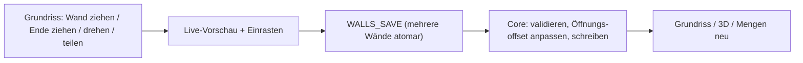

# Plan: Wände im Grundriss bearbeiten (nicht-rechteckige Häuser)

## Context
- Wände sind schon heute Einzelobjekte mit `start`/`end` in [house/storeys/ground.json](c:/Development/weingaerten/house/storeys/ground.json). Gehrung entsteht im Core durch das Schneiden der Linien gleicher Tiefe mit der Nachbarwand. Das funktioniert auch an einspringenden Ecken, also auch beim Versprung in deiner Skizze.
- Was heute fehlt:
  - Der Umriss für die Raumprüfung entsteht nur, wenn alle Wände gleich herum laufen (`nb_e`-Kette).
  - Die Bodenplatte ist ein festes Rechteck.
  - Die Geschosshöhe lässt sich nur in der Datei ändern.
  - Der Core kann Wände nicht schreiben (`OPENING_SAVE` ändert nur Öffnungen).
  - Der Grundriss ist ein reines Server-SVG ohne Bearbeitung.
- Entscheidungen: **freie Einzelwände** (Endpunkte rasten ein), **Räume bleiben Rechtecke**, **Bodenplatte folgt dem Umriss**, **Öffnungen behalten ihre absolute Position**.

## Bedienkonzept Grundriss
- Schalter **„Bearbeiten“** über dem Plan. Im Bearbeitungsmodus liegt über dem Server-SVG eine JS-Ebene mit den Wänden als Bänder (Fußabdruck) und deren Referenzlinien.
- **Wand anklicken** wählt sie aus (blau). Im Seitenpanel stehen Start x/y, Ende x/y und Länge in cm sowie Aufbau, Außenseite und Name, mit den Knöpfen `Drehen 90°`, `Außenseite tauschen`, `Teilen`, `Löschen`.
- **Wand ziehen** verschiebt sie senkrecht zu ihrer Richtung, z. B. eine Nordwand nur nach oben oder unten.
  - Die Option **„Ecken mitziehen“** ist standardmäßig an. Endpunkte von Nachbarwänden, die auf den Endpunkten der gezogenen Wand liegen, wandern dann mit. Die Nachbarn werden dadurch länger oder kürzer, die Ecke bleibt geschlossen.
- **Endpunkt ziehen** verlängert oder kürzt die Wand entlang ihrer Achse. Mit „Ecken mitziehen“ wandert auch ein anhängendes Nachbarende mit.
- **Drehen 90°** dreht um den Startpunkt, links oder rechts. Wände sind immer waagrecht oder senkrecht.
- **Teilen** schneidet die Wand an der Klickposition in zwei Wände. Zieht man danach ein Teilstück weg, entsteht der Versprung aus deiner Skizze. Die Verbindungswand fügt man über `+ Wand` ein. Alternativ erzeugt **„Versprung“** in einem Schritt drei Wände: Teilstück verschoben plus zwei Querwände.
- **`+ Wand`** zieht eine neue Wand mit der Maus auf, achsparallel. Die Außenseite wird automatisch gewählt, nämlich die Seite außerhalb des bestehenden Umrisses. Aufbau ist der Aufbau der zuletzt gewählten Wand.
- **Raster und Einrasten:**
  - Raster 1 cm, mit Shift 10 cm.
  - Endpunkte rasten im Umkreis von 15 cm an Endpunkte anderer Wände ein.
  - Wandlinien rasten an Fluchten anderer Wände ein (gleiche x oder y).
  - Eine Hilfslinie zeigt das Einrasten.
- **Live-Prüfung** markiert rot: Überlappung, offenes Ende (orange), Öffnung außerhalb ihrer Wand. Gespeichert wird mit `Speichern`, `Abbrechen` verwirft. Pfeiltasten verschieben 1 cm, mit Shift 10 cm.
- **Räume** als Rechtecke anklicken: Kanten ziehen, Einrasten an Wand-Innenflächen, `+ Raum`, `Löschen`, Name ändern. Ein L- oder Versprung-Haus bekommt so mehrere Räume.
- **Geschosshöhe** steht als Feld im Panel (cm) und gilt für alle Wände.

## Datenmodell / Core ([weingaerten-core.md](c:/Development/weingaerten/weingaerten-core.md))
1. **Umriss robust:** Die Außenwände werden über gemeinsame Endpunkte zu geschlossenen Ringen verkettet, egal in welcher Richtung die Wände laufen. Dieser Umriss dient für die Raum- und Bodenplattenprüfung und für die Bodenplatte. Bleibt der Ring offen, gibt es eine Warnung „Umriss nicht geschlossen“. Die Gehrung an konkaven Ecken wird im Smoke-Test geprüft.
2. **Bodenplatte folgt dem Umriss:** `foundation` bekommt `{assembly, follow: "outline", overhang: 0, top}` statt `rect`; `rect` bleibt als Alternative. Der Core berechnet das Polygon, also den Außenumriss, um `overhang` orthogonal versetzt. Volumen = Fläche × Dicke. Die Prüfung „Wand auf der Bodenplatte“ läuft per Punkt-im-Polygon. Ausgabe: `foundation.polygon`.
3. **Öffnungen absolut:** Ändert sich der `start` einer Wand entlang ihrer Achse, passt der Core `offset` so an, dass die Öffnung an derselben Weltposition bleibt (`offset' = offset + (start_alt − start_neu)·d`). Bei Drehung oder Richtungsumkehr bleibt `offset` unverändert. Liegt eine Öffnung danach außerhalb, bleibt die Änderung erlaubt; die Öffnung wird als `opening_conflicts` gemeldet und rot markiert.
4. **Neuer Befehl `WALLS_SAVE {storey, upsert: [walls], delete: [ids], rooms?: {upsert, delete}, height?}`:**
   - Atomar, damit „Ecken mitziehen“ mehrere Wände auf einmal ändert.
   - Prüft das ganze Geschoss mit den Änderungen. Neue Fehler wie Überlappung, ungültige Werte, unbekannter Aufbau oder nicht achsparallel führen zur Ablehnung; Öffnungskonflikte nicht (siehe 3).
   - Wand-ids sind eindeutig; neue ids `w-<n>`.
   - Schreibt nur `house\storeys\<id>.json`. `WALL_DELETE` ist darin enthalten (Öffnungen der Wand werden mit gelöscht, nur nach Bestätigung in der Oberfläche).
5. **Regel:** Wände müssen achsparallel sein, sonst Fehler „Wand nicht im 90°-Raster“.
6. Smoke-Test erweitern: Versprung-Grundriss wie in der Skizze (6 Außenwände mit einspringender Ecke) mit geschlossener Gehrung, ohne Überlappung, mit korrektem Umriss und Bodenplattenfläche; Wand verschieben mit mitgezogenen Ecken; Öffnung bleibt absolut; Drehung um 90°; Fehlerfälle; Höhe ändern.

## Web ([weingaerten-web.md](c:/Development/weingaerten/weingaerten-web.md))
7. `/grundriss`: Bearbeitungsmodus wie oben, eingebettete `HOUSE`-Daten, API `/api/walls/save`. Nach dem Speichern wird der Plan neu geladen und die Auswahl bleibt erhalten.
8. `/haus3d` und Grundriss zeichnen die Bodenplatte als Polygon (in 3D extrudiert).
9. `/waende` bekommt den Link „im Grundriss bearbeiten“ (`/grundriss#<wand-id>`); die Wandliste zeigt neue oder gelöschte Wände nach dem Neuladen.
10. `scripts/check_web.py` erweitern (nur lesend; Ablehnung ungültiger `walls/save`-Anfragen prüfen).

## Implementation steps
1. Core-Spezifikation: Umriss-Ringe, Bodenplatte `follow: outline`, 90°-Regel, Öffnungen absolut, `WALLS_SAVE`; Schema `house`/`storey` anpassen; `house.json` auf `follow: outline` umstellen.
2. Core-Code generieren, Smoke-Test mit Versprung-Szenario.
3. Web-Spezifikation: Bearbeitungsmodus im Grundriss (Wände und Räume), Bodenplatte als Polygon, API.
4. Web-Code generieren, Prüfskript, Server neu starten, im Browser durchspielen: Versprung wie in der Skizze bauen, Ecken mitziehen, Raum teilen.
5. Doku und Projektgedächtnis.

## Verification
- `scripts/smoke_baseline.py` → `smoke=OK`, inklusive Versprung-Szenario auf einer Temp-Kopie.
- `scripts/check_web.py` → `check=OK` (prüft keine festen Zählerstände der Benutzerdaten mehr, sondern Struktur).
- Browser: Versprung herstellen, `/mengen` zeigt „Modell gültig“ (nach dem Anpassen der Räume), 3D mit geschlossenen Ecken und passender Bodenplatte.

## Critical Files
- [weingaerten-core.md](c:/Development/weingaerten/weingaerten-core.md) - Umriss, Bodenplatte, WALLS_SAVE, Öffnungs-Offsets
- [weingaerten-web.md](c:/Development/weingaerten/weingaerten-web.md) - Bearbeitungsmodus Grundriss
- [house/house.json](c:/Development/weingaerten/house/house.json) - Bodenplatte folgt Umriss
- [catalog/schema/storey.schema.json](c:/Development/weingaerten/catalog/schema/storey.schema.json), [catalog/schema/house.schema.json](c:/Development/weingaerten/catalog/schema/house.schema.json) - Schemas
- `%LOCALAPPDATA%\non-code-cache\weingaerten-core\weingaerten_core.py`, `...\weingaerten-web\web_server.py` - generierter Code
